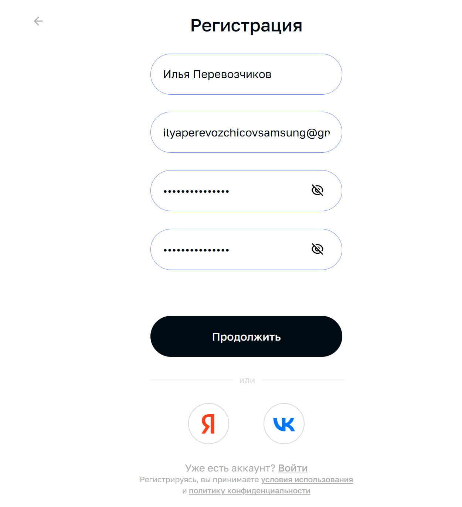

# Тестовое задание QA. Вариант 1: Регистрация и управление доступом

**Сайт для проверки:** https://spaffy.ru
**Браузер:** Yandex (актуальная на момент тестирования)
**Устройство:** Windows 11 / ПК
**Дата тестирования:** 23 октября 2026 г.

---

## Три наиболее существенных находки

1. **Полный отказ работы восстановления пароля (Blocker)** 
   Функция «Забыли пароль?» нестабильна. При первой попытке письмо пришло с задержкой в 3 минуты и ложной ошибкой входа. При повторных попытках (как для учителя, так и для ученика) система выдает ошибку «Не удалось отправить письмо», и письмо не приходит вовсе. Это блокирует доступ к аккаунту при утере пароля.
2. **Ошибка загрузки данных при онбординге учителя (Critical)** 
   На этапе «Закончим настройку профиля» выпадающий список «Экзамены» не загружается, выдавая ошибку «Не удалось загрузить курсы». Кнопка «Отправить» становится неактивной. Ошибка плавающая (при повторной попытке пропала), но она ломает первичное впечатление и может отпугнуть нового пользователя.
3. **Неинформативные сообщения об ошибках (Major)** 
   При вводе неверных данных (или при сбое на сервере) система выдает общую фразу «Что-то пошло не так» или подсвечивает поле красным без пояснений. Пользователь не понимает, что именно нужно исправить, чтобы продолжить.

---

## Баг-репорты

### Находка №1: Блокирующая ошибка восстановления доступа
* **Тип:** Ошибка (Blocker)
* **Название:** Не отправляется письмо для сброса пароля, ложные ошибки.
* **Предусловия:** Пользователь не авторизован, находится на странице «Забыли пароль?».
* **Шаги воспроизведения:**
  1. Ввести email зарегистрированного пользователя (учителя или ученика).
  2. Нажать «Отправить ссылку».
* **Фактический результат:** В первый раз страница грузилась 3 минуты и выдала ложное сообщение о невозможности входа (письмо пришло). При последующих попытках (на другие email) появляется красная ошибка «Не удалось отправить письмо, попробуйте позже», письмо не приходит. Войти в аккаунт со старым паролем теперь нельзя (пишет, что пароль неверный).
* **Ожидаемый результат:** Письмо со ссылкой для сброса должно приходить в течение 1-2 минут. При вводе незарегистрированного email должна быть ошибка формата «Пользователь не найден».
* **Основание ожидания:** Стандартная логика работы функции восстановления доступа.
* **Влияние:** Критическое. Пользователь теряет доступ к аккаунту без возможности восстановления. Обходного пути нет.
* **Скриншот:**  [Ошибка отправки](screenshots/spaffy1.png)

### Находка №2: Ошибка загрузки списка предметов (Онбординг учителя)
* **Тип:** Ошибка (Critical)
* **Название:** Не загружается список «Экзамены» на шаге настройки профиля.
* **Предусловия:** Пользователь зарегистрирован как учитель, находится на втором шаге регистрации.
* **Шаги воспроизведения:**
  1. Заполнить базовые данные, нажать «Продолжить».
  2. На странице «Закончим настройку профиля» кликнуть на выпадающий список «Экзамены».
* **Фактический результат:** Появляется ошибка «Не удалось загрузить курсы. Попробуйте еще раз» (и в списке, и во всплывающем уведомлении). Кнопка «Отправить» неактивна. 
* **Ожидаемый результат:** Список доступных экзаменов загружается, позволяя выбрать предметы и завершить регистрацию.
* **Основание ожидания:** Прямая функциональность шага настройки профиля.
* **Влияние:** Высокое. Новый учитель не может завершить регистрацию. Обходной путь: перезагрузить страницу или вернуться назад (при повторной попытке ошибка пропала).
* **Воспроизводимость:** 1 из 1 (при первой попытке).
* **Скриншот:** [Ошибка загрузки курсов](screenshots/spaffy2.png)

### Находка №3: Неинформативное сообщение об ошибке
* **Тип:** Неудобство (UX)
* **Название:** Общая ошибка «Что-то пошло не так» при регистрации.
* **Предусловия:** Заполнение формы регистрации.
* **Шаги воспроизведения:**
  1. Заполнить поля и нажать «Продолжить» (например, при использовании автозаполнения пароля).
* **Фактический результат:** Под кнопкой появляется надпись «Что-то пошло не так». Форма не отправляется, причина не указана.
* **Ожидаемый результат:** Сообщение должно указывать на конкретную причину (например, «Пароль слишком простой», «Email уже занят»).
* **Основание ожидания:** Стандарты UX-дизайна форм.
* **Влияние:** Среднее. Пользователь не знает, как исправить ошибку. Обходной путь: придумать другой пароль вручную.
* **Скриншот:** [Что-то пошло не так](screenshots/spaffy3.png)

### Находка №4: Исчезновение плейсхолдеров при автозаполнении
* **Тип:** Неудобство (UX)
* **Название:** Текст-подсказка поля исчезает при вставке данных.
* **Предусловия:** Форма регистрации, используется браузерное автозаполнение.
* **Шаги воспроизведения:** Активировать автозаполнение в поле «Имя».
* **Фактический результат:** Вставилось полное ФИО, при этом подсказка «Имя» пропала. Непонятно, требует система только имя или полное ФИО.
* **Ожидаемый результат:** Подсказка должна оставаться видимой (например, подниматься над полем ввода).
* **Основание ожидания:** Стандарт WCAG (доступность интерфейсов).
* **Влияние:** Низкое. Пользователь может ввести неверный формат.
* **Скриншот:**  

---

## ❓ Ответ на отдельный вопрос

**На каком этапе новый пользователь с наибольшей вероятностью не сможет продолжить или ошибётся?**
Наибольший риск возникает на этапе **настройки профиля учителя (выбор экзаменов)** и при **восстановлении пароля**. 
Вывод основан на наблюдении: при первой попытке настройки профиля список предметов не загрузился, а кнопка «Отправить» была заблокирована. В случае с восстановлением пароля ошибка оказалась системной — письма перестали отправляться вовсе. На этих этапах пользователь полностью теряет возможность продолжить работу, а неинформативные сообщения об ошибках («Что-то пошло не так») не дают подсказок к действию.

---

## 🚧 Непроверенные сценарии и следующие шаги

* **Непроверенные сценарии:** Сценарий переключения между учителем и учеником (проверка остаточных данных предыдущего аккаунта), проверка утечки данных после выхода (переход по сохраненной ссылке). 
  * *Причина:* Полный отказ работы восстановления пароля и авторизации заблокировал возможность входа в аккаунты для проведения этих тестов.
* **Следующая важная проверка:** Проверить кэширование данных при переключении ролей (учитель -> ученик) после исправления багов с авторизацией. 
* **Ошибки, которые легко пропустить при поверхностном тестировании:** Плавающие баги (flaky bugs), такие как нестабильная загрузка списка экзаменов и долгая загрузка страницы после сброса пароля. При однократном прохождении «успешного» сценария их легко не заметить.
